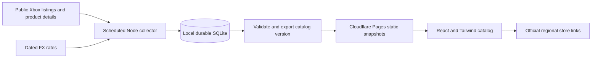

# Full Xbox regional catalog: free-first implementation plan

Prepared 2026-10-11. Planning only; no scanner, scheduler, hosting migration, or production change is authorized by this document itself.

## Decision

Build a durable catalog collector independently from the website. Start with Node/TypeScript and SQLite on the existing Windows PC, and publish versioned, compact catalog snapshots to a static website on Cloudflare Pages. Reuse the current React/Tailwind interface, product parser, decimal calculations, and browser watchlist. Keep the existing Vercel app working during the transition.

This targets $0 additional hosting/data-service fees at modest traffic. It requires an existing computer, disk, electricity, internet, and maintenance. When the collector is off, the website remains accessible with dated prices. A fully unattended cloud collector is a later option, subject to runtime, storage, source-access and free-tier validation. Do not promise every global price live, permanently free, or a provably exhaustive Xbox inventory before source discovery is proven.

## Product scope

- Aim to index all publicly discoverable, currently listed Xbox console games in each validated regional store, then editions, bundles, expansions, add-ons and in-game currency. Keep categories separate. PC-only products need an explicit filter, not silent inclusion.
- Preserve exact Microsoft product IDs and platform/edition/entitlement distinctions. Regional substitutes or similarly named editions are not automatically equivalent.
- Retain previously discovered delisted products as historical records; do not promise recovery of the entire historical Xbox/360 marketplace.
- Start with US/TR/IN/JP, expand to a pilot group of about 12 validated stores, then every store the source registry can successfully verify. Do not equate every ISO country or Xbox service region with an available digital game storefront.
- Offer country selection, native price and chosen display currency, cheapest verified country, regional difference in money and percent, sale dates, store links, filters, search, and price history collected from our start date.
- Show counts for discovered products, attempted regional checks, successful checks, fresh comparable prices, and unresolved regions. “All indexed games” is honest; a guessed “100% of Xbox” denominator is not.
- Treat XB Deals and Xbox-Now as feature references. Do not depend on scraping their catalogs, private APIs or historical price databases.

## Phase 0 — Documentation and discovery evidence

### What is already known

The current working tree includes unfinished catalog changes. Preserve them and their screenshots; this plan does not overwrite or certify them.

| Existing pattern | Reuse / gap |
| --- | --- |
| `src/lib/services/catalog-sync.ts` | Draft discovery uses two US Game Pass feeds plus 31 seeds. It cannot enumerate the whole Store. |
| `discoverMicrosoftGameIds()` | Useful supplemental feed adapter; replace the implied complete-catalog meaning with explicit source coverage. |
| `syncCatalogBatch(batchSize = 25)` | Existing `bigIds` batching is a candidate to validate, not a documented universal API limit. Products with any snapshot are skipped; partial/expired regions are not revisited. Attempted chunks are counted as success even after errors. |
| `getMasterCatalog(...)` | Useful catalog DTO/filter sketch. Cached-only comparisons need existing FX; a pristine sync may show native amounts without USD. Avoid loading/comparing every product on each page request. |
| `src/lib/providers/catalog-parser.ts` | Preserve conservative public-offer and entitlement parsing. |
| `src/lib/http/upstream.ts` | Reuse timeout/concurrency/retry concepts; retain existing Retry-After handling and add collector-wide pacing and durable retry state. |
| `src/lib/regions.ts`, `src/lib/providers/fx.ts` | Four hard-coded markets and TRY/INR/JPY requests must become a validated market/currency registry. |
| `src/lib/deployment.ts`, `README.md` Vercel section | Vercel uses ephemeral in-memory SQLite; this is not durable shared catalog storage. |
| `src/components/catalog-browser.tsx`, `src/app/api/catalog/` | Preserve draft browser/filter UI; validate inputs and move scanning out of public page requests. |

### Allowed APIs / source status

1. Product details: the existing adapter uses `https://displaycatalog.mp.microsoft.com/v7.0/products` with product IDs, market, language and Details fields. Microsoft’s own winget source contains a related product-detail URL. This supports investigating that endpoint, not a claim that an anonymous bulk enumeration service has a supported public contract. Preserve sanitized response fixtures and adapter versions. [Microsoft source](https://github.com/microsoft/winget-cli/blob/master/src/AppInstallerCommonCore/MSStoreDownload.cpp)
2. Product schemas: consult Microsoft’s Store schema reference for product/SKU/availability distinctions; reconcile it with observed responses. Do not copy winget’s preferred SKU selection into game pricing. [Store schemas](https://learn.microsoft.com/en-us/windows/uwp/monetize/data-schemas-for-store-products)
3. Discovery: investigate the public Xbox browse UI and its actual pagination requests. Record observed endpoint, request shape, cursor/offset behavior and termination evidence before implementing an adapter. No invented “get all games” endpoint. [Xbox browse](https://www.xbox.com/en-US/games/browse)
4. Regions: derive candidates from official storefront/region information, then validate currency, locale, console platform and returned market. Service availability alone is insufficient. [Xbox regions](https://www.xbox.com/en-US/regions)
5. FX: Frankfurter documents `/v2/currencies` and `/v2/rates?base=USD&quotes=...`. Validate coverage and dated rates per currency. Missing FX leaves the native price visible and prevents converted rankings. [Frankfurter API](https://frankfurter.dev/)
6. Publishing: use the documented static export and direct-upload patterns, not the current dynamic API routes inside a static build. [Next static export](https://nextjs.org/docs/app/guides/static-exports), [Pages upload](https://developers.cloudflare.com/pages/how-to/use-direct-upload-with-continuous-integration/)

### First implementation deliverable: a discovery proof

Run a bounded, read-only probe before a full crawl. Validate a regional browse source, at least three successive pages and an end-of-list traversal of a bounded category; prove pages are not repeats. Include a non-Game-Pass game, a regional-only result, a bundle, an expansion, a currency pack, a preorder and a delisted/missing listing. Compare batch and individual detail lookup for a small sample, including omitted IDs.

Record request/response shapes, source rules, response sizes, latency, request counts, duplicate rates, stop conditions and failures in `docs/catalog-source-validation.md`. Use source-exposed category/platform/date partitions only if needed and observed. Querying letters or merely adding more seed titles cannot establish coverage. Review applicable source usage rules before sustained collection; stop/back off on access denial rather than bypass it.

**Exit gate:** at least one repeatable discovery adapter beyond Game Pass, trustworthy regional responses and resumable pagination are demonstrated. If no broad source is available, report measured partial coverage and evaluate an authorized feed; do not label seed-based search as the full Store.

## Architecture

The website reads saved data. It does not crawl every country whenever someone opens a card. Heavy discovery, parsing, search-index construction and rankings happen in the collector/exporter. Personal watchlists and baskets remain in the browser; publishing includes catalog data only.

## Phase 1 — Durable state and trustworthy synchronization

**Implement:** Extract reusable pure contracts/parser/pricing code from framework-specific imports, preserving existing behavior. Add a standalone collector entry point and versioned SQLite migrations. Copy the repository’s bound-query and migration patterns rather than replacing pricing rules.

Proposed records:

| Record | Key / essential fields |
| --- | --- |
| Product | `productId`; type, platforms, publisher, metadata, first/last seen |
| Relationship | parent ID, child ID, relation, evidence; region-specific identities remain separate |
| Market | code, locale, expected currency, storefront status, validation date |
| Discovery state | source + market + partition; cursor, run ID, completion, observed count |
| Current offer | product + market + entitlement; native amount, currency, eligibility, checkedAt, expiresAt, offer dates |
| Check attempt | product + market; last attempt, error class, next retry; never overwrite successful data with an outage |
| Price change | product + market + entitlement + observed time; append only when price/availability changes |
| Job | durable key, priority, next run, lease, retries, terminal outcome |
| FX | currency, provider, effective date, fetched time, USD conversion |
| Publication | version, schema, checksum, counts, coverage and timestamps |

Schedule by product AND region, not “product has any snapshot.” Distinguish checked, succeeded, failed, confirmed missing, and unresolved. Bound fetches, honor Retry-After, reduce concurrency on throttling, and resume after restart. A batch omitting an ID must not immediately prove “not sold”; confirm individually or retain unknown status. Expiry/changed sales enqueue work again.

**References:** `src/lib/services/catalog-sync.ts`, `src/lib/db/`, `src/lib/http/upstream.ts`, `tests/catalog-sync.test.ts`, Store schemas above.

**Verify:** interrupt/restart without lost cursor; repeat job is idempotent; partial region failure retries just missing work; every-failed batch reports zero successes; zero-price products remain valid; expired entries requeue; fixture sync cannot claim writes it never made; fresh installation obtains FX. Back up/restore SQLite consistently.

**Guard:** no ephemeral Vercel database as source of truth; no public unauthenticated catalog-sync endpoint (origin checks alone are not authentication); no silent catches hiding a broken source; no network work inside DB transactions. No new scheduler should run until tested with bounded fixtures and a small live sample.

## Phase 2 — Broad discovery and region expansion

**Implement:** Build adapters from Phase 0’s captured requests. Persist IDs from the union of regional browse sources, supported categories, current deals/new releases, and verified parent/add-on relationships. Keep Game Pass and seeds as supplements. Store per-source provenance and deduplicate IDs; follow relationship graphs with visited sets and bounded traversal.

Use a validated registry rather than hard-coded four-country unions. Update the market/currency schemas in contracts.ts, fx-parser.ts, FX requests and comparison refresh logic together; changing regions.ts alone is insufficient. Pilot additional markets such as GB, CA, BR, MX, AU, DE, PL and ZA only after validation, then expand to the remaining supported stores. Do not assume all EUR stores have identical offers. Label unsupported or temporarily inaccessible regions distinctly.

**References:** Phase 0 source report, `src/lib/regions.ts`, `src/lib/providers/microsoft.ts`, `src/lib/services/catalog-sync.ts` discovery pattern, official Xbox regions.

**Verify:** regional-exclusive products appear; non-Game-Pass games and DLCs appear; pages reach observed termination without looping; repeated full passes stabilize within expected new releases; independent sampled titles are found. Reconcile upstream counts only when their meaning is known. Failure in one region does not erase it or its products.

**Guard:** neither search result counts nor Game Pass size prove Store coverage. “Not returned” is not proof of delisting. Require repeat confirmed absence before changing historical availability.

## Phase 3 — Price correctness and affordable refresh

**Implement:** Reuse parser, entitlement matching and decimal currency arithmetic for every validated region. Refresh FX independently of native prices. Store compact current offers and change history; keep large raw fixtures only for selected diagnostics with retention limits.

Initial scheduling targets, to adjust after measurement:

| Work | Target cadence |
| --- | --- |
| Known active deals, popular products and operator watchlist | Every 3–6 hours while the collector runs |
| New listings and upcoming known sale expiry | Daily discovery plus priority checks around observed expiry |
| Remaining active catalog | Rotating 24–72 hour checks |
| Confirmed unavailable/delisted listings | Weekly, with bounded retry rules |
| FX | Daily, using provider effective dates |
| Publish current snapshot | Up to four times daily after successful validation |

Freshness must survive publishing: keep per-region `checkedAt`, offer expiry, FX date and `validUntil`. Explicitly separate the current one-hour cache TTL from the comparator six-hour maximum rank age: the draft catalog currently excludes prices after one hour. For the snapshot viewer, propose a tested six-hour maximum verification window independent of the cache refresh TTL, shortened by known offer expiry and FX validity. This is a deliberate policy change, not existing behavior; label values with their actual check time. Older values remain searchable as **last observed prices**, not current cheapest-country claims. The viewer expires rankings based on time even when no new snapshot arrives. Delayed collection must not make an old deal look newly checked.

Homepage rankings use only fresh comparable offers; the complete catalog still includes unpriced/stale entries with explanations. Group only verified matching editions. A regional variant must be excluded from that group without invalidating all other matching countries. Persist actual parent/add-on relationships rather than relying on title similarity. Use “lowest price we have recorded since DATE,” not an unsupported lifetime low. Compute it across retained history or persistent extrema, not the current latest-50-history-row window. Popularity needs dated official chart evidence when available; otherwise label it curated, not best-selling.

**References:** `src/lib/providers/catalog-parser.ts`, `src/lib/pricing/`, `src/lib/services/comparison.ts`, `src/lib/providers/fx.ts`, Frankfurter docs.

**Verify:** free/missing prices, memberships, bundles, consumable amounts, sales ending, mismatched currency, stale FX, region outages and entitlement mismatches. A timed test must show a published winner expiring without another deployment.

**Guard:** do not relax correctness to fill the catalog. Regional difference is not guaranteed resale profit, eligibility or checkout availability.

## Phase 4 — Fast static catalog and search

**Implement:** Keep React/Tailwind and the blue/green design. Add a separate static viewer/build target sharing reusable components. The current app cannot be static-exported unchanged: it has request-dependent routes, server-side SQLite and dynamic product routes. Use a static product shell such as `/product?id=...` for the free viewer; keep existing Vercel links working during migration.

Export a compact title/alias index, lightweight listing records, precomputed sort orders and bounded product-detail shards. Fetch only the selected page/detail data; do not load the full regional matrix on a phone. Build normalization, common abbreviations and fuzzy matching offline or in a browser Web Worker. Index every discovered product, not only products with prices. Load images lazily and reuse permitted official image URLs without archiving artwork.

Add games/DLC tabs, country inclusion/exclusion, platform/type/publisher, sale/free/availability filters, price bounds, difference amount/percent sorting, and pagination. Cards show cheapest verified country or clearly dated last observation. Details show regional timestamps, price provenance and official store links. Preserve browser watchlist, basket and export behavior. Static-only mode links to the store for current verification; it cannot silently enqueue a server refresh. Live refresh needs the optional rate-limited API described below.

**References:** `src/components/catalog-browser.tsx`, `src/components/top-opportunities.tsx`, existing search components and browser-library contracts; Next static-export guide above.

**Verify:** representative full-size synthetic data; first results under two seconds after assets load on the test device; search under 200 ms after index load; initial catalog payload target under 2 MB compressed, splitting further if needed. Check 320/390/768/1440px layouts, keyboard controls, pagination, accents/typos and unavailable products. Use measured budgets, not an assumed game count.

**Guard:** no per-view full-catalog comparison loop; no unbounded JSON response or one mandatory download containing every regional price; no paid search service necessary for the first version.

## Phase 5 — Free publication and operation

**Implement:** Schedule the collector with Windows Task Scheduler and resumable jobs. Build/publish from the authoritative local database. Create immutable versioned shards plus a manifest containing schema, hashes, coverage and checked-time ranges. Validate every referenced shard before publishing a complete deployment; pin a session to one version and keep the prior good deployment for rollback. Preserve old version assets long enough for active sessions, within the file budget. Empty or unexpectedly incomplete exports fail publication.

Cloudflare Pages is the proposed host for the free static viewer/data. Use its provided domain first. Planning limits checked on 2026-10-11: 500 builds/month, 20,000 files/site, 25 MiB/file. Budget at most four data publications/day (~124/month) plus code deployments; confirm how the selected direct-upload path counts and monitor actual usage. Use hundreds of shards, not one file per product-region. Static requests are free; functions have separate quotas. [Pages limits](https://developers.cloudflare.com/pages/platform/limits/), [Pages pricing](https://developers.cloudflare.com/pages/functions/pricing/)

Do not put changing raw datasets or the private SQLite database into ordinary Git commits. Keep code/configuration in Git, persistent data locally, catalog exports in the deployment, and backups on an existing separate disk if available. Keep publication credentials outside source control. Automatic cloud backups require a separately validated storage allowance.

**References:** Pages direct-upload guide above; existing database backup guidance in `README.md`.

**Verify:** full rebuild from local DB; rollback; interrupted export; corrupt/missing shard; sleep/offline collector; expired price UI; no personal state or secrets in export. Display last successful discovery, price collection and publication separately. Reserve at least 20% of hosting/file budgets; stop optional work before exhausting allowances.

**Guard:** existing Vercel deployment remains until the replacement is verified. Vercel Hobby is for personal non-commercial use, so do not assume it qualifies for an internal resale/business tool. Its daily-only Hobby cron also is not the collector architecture. [Vercel Hobby](https://vercel.com/docs/plans/hobby), [cron limits](https://vercel.com/docs/cron-jobs/usage-and-pricing)

## Capacity model and alternatives

Illustration only, NOT a measured Xbox catalog size: 20,000 products × 40 stores = 800,000 product-region observations. If batches of 25 prove reliable, one sweep needs about 32,000 detail requests before discovery, retries and supplemental requests. At an illustrative permitted pace of one request/second, that is about 8.9 hours. Measure acceptable pacing; one/second is not Microsoft's documented allowance. This is why hot products and the long tail need different refresh cadences.

At 250 bytes per compact current observation, the regional data alone is roughly 200 MB before compression, metadata, search indexes and history. Benchmark real payload sizes in Phase 0/3. Keep history local with change-only records and retention/rollups. Publishing snapshots can support a broad catalog without rewriting a cloud row for every check.

| Option | Role and limitation |
| --- | --- |
| Existing PC + SQLite + static Pages | Recommended $0 hosting baseline. Durable history and flexible collection; updates depend on PC uptime and local backups. |
| GitHub Actions collector | Possible later unattended job. Standard public-repository runners have free execution; private GitHub Free has 2,000 included minutes/month. Jobs have a six-hour limit. Schedules may be delayed/dropped or disabled after public-repo inactivity. Persistent checkpoints/history and artifact/storage budgets still need a design; caches are not the authoritative database. Use only if the project workload qualifies and measured runs fit. |
| Thin Cloudflare Worker + D1 | Optional later search/refresh API when static filtering is insufficient. Heavy parsing remains in the collector. Free D1 allows 5M rows read/day, 100k written/day, 5 GB/account but only 500 MB/database. Index writes count too. It is not suitable for naively rewriting 800k prices daily. Benchmark compact/delta storage before adoption. |
| Paid always-on service | Future choice only if uptime/freshness/traffic exceeds the free model. No paid service is necessary to validate discovery or build the first broad catalog. |

[GitHub billing](https://docs.github.com/en/billing/concepts/product-billing/github-actions), [job limits](https://docs.github.com/en/actions/reference/limits), [schedule behavior](https://docs.github.com/en/actions/reference/workflows-and-actions/events-that-trigger-workflows), [D1 pricing](https://developers.cloudflare.com/d1/platform/pricing/), [D1 limits](https://developers.cloudflare.com/d1/platform/limits/).

## Phase 6 — Release verification and expansion gate

**Implement:** Assemble a coverage/freshness report from persisted source evidence, then run a seven-day pilot across the initial regions before increasing scope. Record requests/day, success rate, retry backlog, runtime, bytes, DB growth, published sizes, UI performance and actual platform use.

**References:** Phase 0 evidence, fixtures and tests from each phase, existing `docs/verification.md`, provider/hosting documentation above.

**Verify:** test suites and production/static builds; sample games and DLCs against official regional pages; no unexplained cursor loops or missing pages; cross-edition isolation; stale/failure states; no reported success on all-failed batches; restore/rollback drill; mobile/browser flows. Audit changed code for swallowed provider errors, hard-coded four-market loops, unvalidated pagination and dynamic-only imports in the static target.

**Release gate:** documented discovery coverage, reproducible publication, no critical pricing regressions, truthful freshness UI and measured free-budget headroom. Expand markets gradually only while these remain true. If the source cannot expose everything, publish its measured coverage and remaining gaps instead of asserting completion.

## Suggested delivery sequence

Engineering estimates, excluding provider-access delays and elapsed pilot time:

1. Discovery proof and capacity measurements: 1–3 focused days.
2. Durable collector, truthful job state, dynamic regions: 3–5 days.
3. Broad discovery, FX and scheduled pricing: 3–5 days.
4. Static catalog/search and snapshot publication: 3–5 days.
5. Verification and seven-day monitored pilot; wider rollout follows the evidence.

Rough total: 2–4 weeks of focused engineering plus the pilot, subject to the discovery gate. The first milestone is **a resumable broad catalog in the existing four regions**, not a claim of global completeness. That proves the difficult part before expanding the country matrix.

Feature references reviewed: [XB Deals](https://xbdeals.net/us-store) for regional browsing, deals and watchlists; [Xbox-Now](https://www.xbox-now.com/en/game-comparison) for country selection and worldwide comparisons. Neither is a proposed upstream database.
